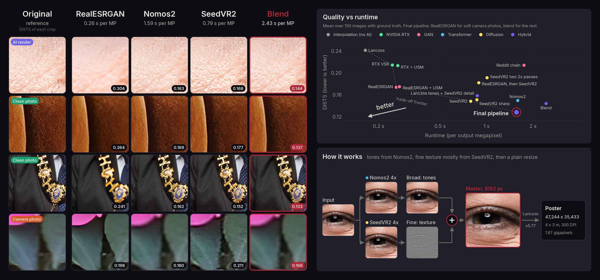

# gigapixel-upscale

Upscales an image to about 1.67 gigapixels, the pixel budget of a 4 x 3 m poster at 300 DPI, and writes a print-ready TIFF. The aspect ratio of the source is kept, nothing is cropped: a 4:3 image lands at 47,244 x 35,433 px, a square one at about 40,900 x 40,900.

It runs in two stages. A ComfyUI workflow takes the source to an 8192 px master with AI upscalers. A plain resize then takes the master to the poster size, because a second AI pass at that scale only turns grain into fake scratches. I measured every choice in here on 150 images with ground truth (60 camera photos, 60 clean photos, 30 AI renders) against a dozen other methods (RTX Video Super Resolution, RealESRGAN, SeedVR2 variants and others).



## How it works

1. The source is fitted into an 8192 x 8192 box (never more than 4x, past that SeedVR2 invents material).
2. **Nomos2** (4x, faithful and clean) and **SeedVR2 7B** (one-step diffusion, adds real texture) both upscale it to that size. SeedVR2 can be swapped for any other generative upscaler, see below.
3. A frequency blend keeps tones and shapes from Nomos2 and takes fine texture from a 25/75 Nomos2/SeedVR2 mix. That beats either model alone on AI renders and clean photos.
4. For soft or noisy camera shots a switch uses **RealESRGAN** instead, which wins on those.
5. The 8192 master is resized to the poster pixel budget, tagged 300 DPI, given a colour profile and saved as TIFF.

Stage 1 runs in ComfyUI on a GPU, stage 2 runs anywhere, a laptop is fine (21 s and 240 MB of RAM for a 1.67 GP poster).

### Using another generative upscaler

SeedVR2 is one choice of detail source, not a requirement. The blend only needs a second upscale of the same image at the same size, so any generative upscaler can take its place: open models like SUPIR or a newer SeedVR, or closed services like Magnific or Topaz.

- In ComfyUI, replace the SeedVR2 nodes with the other model's nodes, or with a Load Image node holding the external result, and wire it where SeedVR2 went into **Detail mix**.
- The result has to line up pixel for pixel with the Nomos2 output: the size the **Stage 1 size** node gives, no crop, no shift. Resize it to that size if the service returns another one.
- Keep creativity settings low, Magnific's especially. The blend takes shapes and tones from Nomos2, so anything the other model moves or redraws shows up as a double edge.
- The 0.75 detail share and the σ 0.75 split were measured with SeedVR2 only. Check a few crops at 100 percent with another model and adjust **Detail mix**.
- The command line always runs the bundled SeedVR2 workflow.

## Install and setup

### Requirements

- A ComfyUI server, 0.28.0 or newer (full runs on 0.30.0, fresh install checked on 0.40.0), with ComfyUI-KJNodes 1.1.4 or newer (the install script pins 1.5.0).
- A GPU with about 40 GB of VRAM for a 4:3 source, more for a square one. Tested on an RTX PRO 6000.
- The four models below, even if you only ever use the camera switch: ComfyUI validates both branches.
- For the command line: [uv](https://docs.astral.sh/uv/) and Python 3.12. Linux or macOS (WSL on Windows).

### ComfyUI side

```sh
COMFYUI_DIR=/path/to/ComfyUI scripts/install.sh
```

It clones ComfyUI-KJNodes at a pinned commit (skipped if you already have it), installs its Python packages, downloads the four models into the right folders and checks their sha256. Restart ComfyUI afterwards.

You can also just open the workflow: its missing-model dialog lists the four files with their links.

On a machine without an NVIDIA GPU, KJNodes logs that `PatchTritonVAE` could not be imported. That node needs `triton` and is not used here, ignore it.

> [!NOTE]
> In a browser, the download button of that dialog only opens the link. Move each file into the folder it names yourself (`models/upscale_models`, `models/diffusion_models`, `models/vae`).

### Command line side

```sh
git clone git@github.com:vbraye-pop/gigapixel-upscale.git
cd gigapixel-upscale
uv sync
```

## Usage

### In ComfyUI

Drag `workflows/gigapixel_upscale.json` into ComfyUI, load your image in **Source image**, set the orange **Camera photo switch**, and queue. The read me note inside the workflow has the poster scale to use for each aspect ratio.

It saves two files: `gigapixel/master` (the 8192 px master, look at this one) and `gigapixel/poster` (the full-size PNG). ComfyUI writes no DPI tag, so either set 300 DPI in Photoshop (Image Size, Resample off) or run the master through `gigapixel-upscale poster` below, which is also much faster than writing and downloading a 1.67 GP PNG from a remote server.

### From the command line

```sh
export COMFY_URL=https://your-pod-8188.proxy.runpod.net

# source to poster TIFF, both stages
uv run gigapixel-upscale all photo.png

# or one stage at a time
uv run gigapixel-upscale run photo.png -o out/          # ComfyUI stage, downloads out/photo_master.png
uv run gigapixel-upscale poster out/photo_master.png     # local stage, writes out/photo_poster_300dpi.tif
```

`run` uploads the source under a unique name (safe on a shared server), queues the workflow without its poster nodes, shows progress, and downloads the master. Ctrl-C cancels the job on the server.

#### Options

- `--camera`: soft or noisy camera shot, use RealESRGAN instead of the blend.
- `--detail 0.75`: SeedVR2's share of fine detail. `0` is plain Nomos2, worth trying on very smooth fabric.
- `--server URL`: ComfyUI address, defaults to `$COMFY_URL`.
- `--megapixels 1674` or `--long-side PX`: poster size, aspect kept. The default is the 4 x 3 m at 300 DPI budget.
- `--dpi 300`: DPI written in the file. It only changes the tag, never the pixels.
- `--profile-from SOURCE` (`poster` only, `all` does it by itself): carry the source's colour profile over instead of assigning sRGB.
- `--bigtiff`: only needed if a TIFF would pass 4 GB, which LZW keeps well away from.

## Which switch setting

- **false** (default): AI renders and clean, sharp photos, studio product shots included.
- **true**: only soft or noisy camera shots, from a phone, at high ISO or slightly out of focus. On those SeedVR2 draws dark halos around edges and RealESRGAN stays faithful.

If unsure, leave it false.

## Output

A TIFF at about 1.67 GP, tagged 300 DPI, LZW compressed, about 0.55 to 1.1 GB. ComfyUI drops colour profiles, so the poster gets the source's own profile when it is RGB, else sRGB (assigned, never converted).

> [!NOTE]
> Print shops usually want 100 to 150 DPI at this size, since a 4 m poster is seen from a few metres. Ask them before sending 1.67 GP, `--dpi 150 --megapixels 418` gives the same 4 x 3 m at 150 DPI. Also ask about bleed, and send RGB: their RIP converts to its own ink profile.

The workflow resizes with Lanczos, the command line with libvips bicubic (libvips enlarges with bicubic whatever the kernel). The two differ by under 1/255 on average.

## Timing

On an RTX PRO 6000, models already loaded:

| Source | Mode | Stage 1 (GPU) | Total with `all` |
|---|---|---|---|
| 2048 x 1536 | blend | 143 s | 168 s |
| 2048 x 2048 | blend | 139 s | |
| 2048 x 2048 | camera | 17 s | |

The first job after the server starts also loads 9 GB of models. Writing the poster PNG inside ComfyUI adds several minutes on one CPU core, which is why the command line makes the poster locally.

## Limits

- Use a source of at least 2048 px on its long side. Smaller sources are capped at 4x, so the poster ends up softer.
- Check fine print, like packaging text, at 100 percent. Small text is where every upscaler fails first.
- On very smooth textures (velvet, satin) plain Nomos2 is sometimes more faithful than the blend: try `--detail 0`.

## Models

| File | Folder | Size | Source | License |
|---|---|---|---|---|
| 4xNomos2_hq_dat2.safetensors | upscale_models | 140 MB | [Phips/4xNomos2_hq_dat2](https://huggingface.co/Phips/4xNomos2_hq_dat2), by Philip Hofmann | CC BY 4.0 |
| RealESRGAN_x4plus.pth | upscale_models | 67 MB | [xinntao/Real-ESRGAN](https://github.com/xinntao/Real-ESRGAN/releases/tag/v0.1.0) | BSD 3-Clause |
| seedvr2_7b_int8_convrot.safetensors | diffusion_models | 8.3 GB | [Comfy-Org/SeedVR2](https://huggingface.co/Comfy-Org/SeedVR2) | Apache 2.0 |
| seedvr2_ema_vae_fp16.safetensors | vae | 501 MB | [Comfy-Org/SeedVR2](https://huggingface.co/Comfy-Org/SeedVR2) | Apache 2.0 |

## Development

```sh
uv run pytest            # no GPU needed: sizes, graph patching, workflow consistency, client, poster
uv run ruff check . && uv run ruff format --check .
```

The workflow tests check `src/gigapixel_upscale/workflow_api.json` and `workflows/gigapixel_upscale.json` against `tests/fixtures/object_info.json`, a trimmed `/object_info` from a working ComfyUI. If you edit the workflow in ComfyUI, save it over `workflows/gigapixel_upscale.json`, export the API version over `workflow_api.json`, and keep the node titles the command line patches (`graph.TITLES`).
