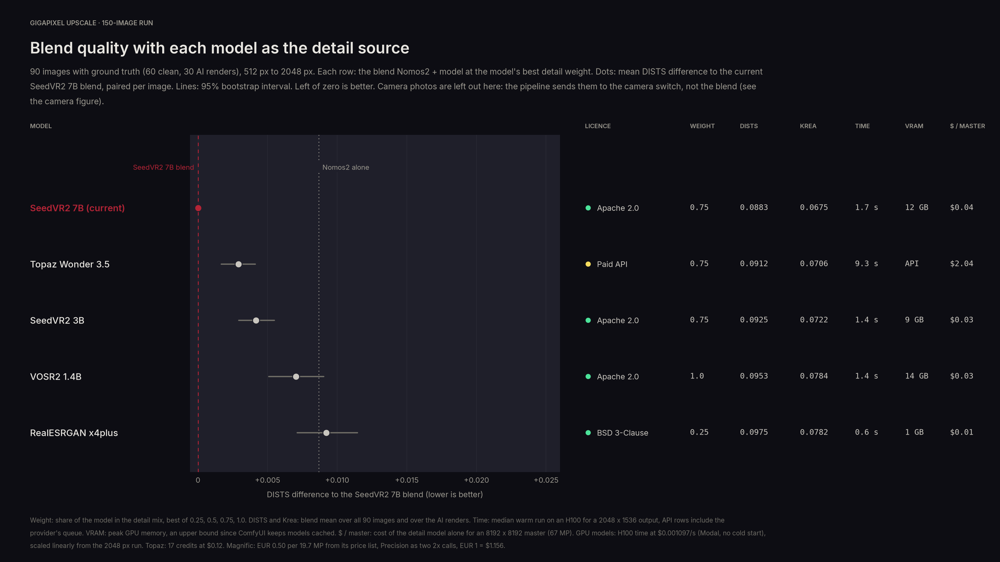
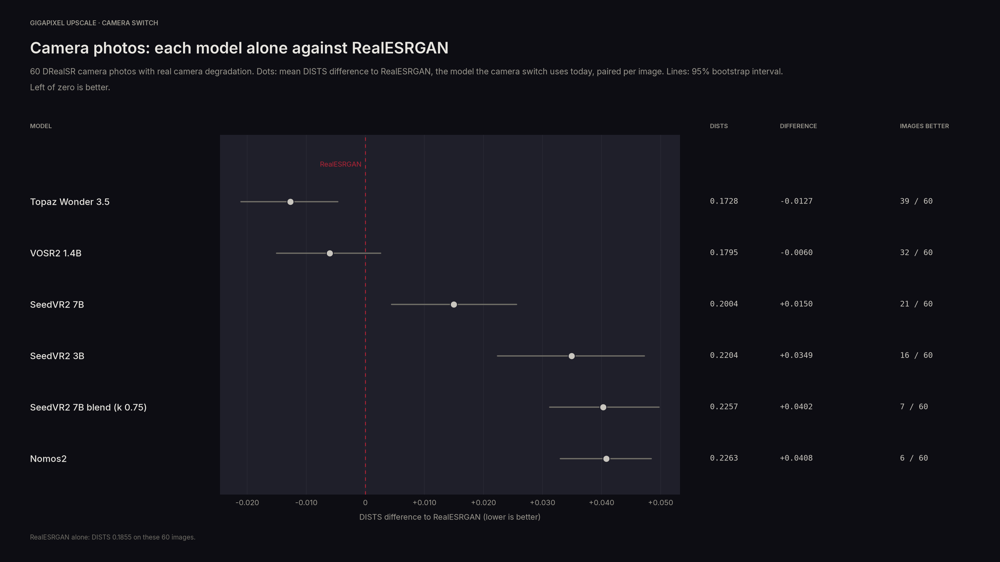
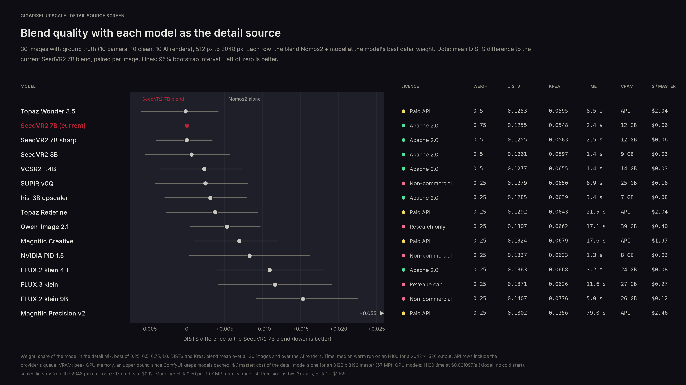

# bench

Which model should feed the blend its fine detail. SeedVR2 can be swapped for any generative upscaler (see the main README), this measures whether one does better. It runs headless ComfyUI on [Modal](https://modal.com) and calls the Topaz and Magnific APIs.

## Method

Every candidate upscales the same low-res inputs 4x, 512 px to 2048 px, and is scored against the ground truth:

- **Blend**: `blur(Nomos2) + highpass((1 - k) Nomos2 + k candidate)` for k = 0.25, 0.5, 0.75 and 1, keeping the candidate's best k. DISTS and LPIPS averaged over the four image quarters, like the original benchmark.
- **Raw**: the same metrics on the candidate's own output.
- **Drift**: CIEDE2000 and PSNR on a blurred copy, and the shift in pixels from phase correlation. The blend takes shapes and tones from Nomos2, so a candidate that moves or recolours the image leaves double edges.
- **Cost**: warm run time on an H100, scaled to an 8192 x 8192 master at $0.001097/s, or the provider's list price for the APIs.

Prompted models get one fixed prompt (`graphs.PROMPT`). Each graph follows the model's official Comfy template.

The set: 60 camera photos (DRealSR), 60 clean photos (LSDIR), 30 Krea 2 renders. A 30-image screen (`screen30.txt`) ruled models out, then the survivors ran on all 150 (`all150.txt`).

## Results

### 150 images

Camera photos are scored on their own: the pipeline sends them to the camera switch, never to the blend.



| Clean photos and AI renders (90) | k | Blend DISTS | vs SeedVR2 7B, 95% interval | Raw DISTS | $ / master |
|---|---|---|---|---|---|
| SeedVR2 7B | 0.75 | 0.0883 | | 0.1121 | 0.04 |
| Topaz Wonder 3.5 | 0.75 | 0.0912 | +0.0029 [+0.002, +0.004] | 0.1192 | 2.04 |
| SeedVR2 3B | 0.75 | 0.0925 | +0.0042 [+0.003, +0.005] | 0.1398 | 0.03 |
| VOSR2 1.4B | 1 | 0.0953 | +0.0070 [+0.005, +0.009] | 0.1111 | 0.03 |
| Nomos2 alone | | 0.0970 | +0.0087 | 0.0970 | 0.03 |
| RealESRGAN x4plus | 0.25 | 0.0975 | +0.0092 [+0.007, +0.011] | 0.1645 | 0.01 |



| Camera photos (60), model alone | DISTS | vs RealESRGAN, 95% interval | Images better |
|---|---|---|---|
| Topaz Wonder 3.5 | 0.1728 | -0.0127 [-0.021, -0.005] | 39 / 60 |
| VOSR2 1.4B | 0.1795 | -0.0060 [-0.015, +0.002] | 32 / 60 |
| RealESRGAN x4plus | 0.1855 | | |
| SeedVR2 7B | 0.2004 | +0.0150 | 21 / 60 |
| SeedVR2 7B blend | 0.2257 | +0.0402 | 7 / 60 |

- SeedVR2 7B at k = 0.75 stays. Every other detail source is worse on clean photos and AI renders, Topaz Wonder 3.5 included.
- The blend beats raw SeedVR2 7B by 0.018 on clean photos (56 of 60 images) and 0.035 on AI renders (29 of 30).
- On camera photos the blend is worse than RealESRGAN alone, which is what the camera switch is for. VOSR2 may beat RealESRGAN there but the interval crosses zero. Topaz does, at $2.04 per master.

By image type: [full_by_type.png](results/full_by_type.png).

### 30-image screen



| Model | Licence | Blend DISTS | vs SeedVR2 7B, 95% interval | Colour drift | Shift px |
|---|---|---|---|---|---|
| Topaz Wonder 3.5 | paid API | 0.1253 | -0.0002 [-0.006, +0.004] | 1.87 | 0.80 |
| SeedVR2 7B | Apache 2.0 | 0.1255 | | 1.63 | 0.17 |
| SeedVR2 7B sharp | Apache 2.0 | 0.1255 | +0.0000 [-0.004, +0.003] | 1.68 | 0.18 |
| SeedVR2 3B | Apache 2.0 | 0.1261 | +0.0006 [-0.005, +0.006] | 1.90 | 0.17 |
| VOSR2 1.4B | Apache 2.0 | 0.1277 | +0.0023 [-0.004, +0.007] | 1.18 | 0.22 |
| SUPIR v0Q | non-commercial | 0.1279 | +0.0025 [-0.004, +0.008] | 1.96 | 0.15 |
| Iris-3B upscaler | Apache 2.0 | 0.1285 | +0.0031 [-0.003, +0.008] | 1.90 | 0.19 |
| Topaz Redefine | paid API | 0.1292 | +0.0037 [-0.003, +0.009] | 2.43 | 0.17 |
| Qwen-Image 2.1 | research only | 0.1307 | +0.0053 [+0.000, +0.010] | 4.71 | 3.30 |
| Magnific Creative | paid API | 0.1324 | +0.0069 [+0.001, +0.012] | 4.19 | 0.16 |
| NVIDIA PiD 1.5 | non-commercial | 0.1337 | +0.0083 [+0.000, +0.016] | 6.88 | 1.70 |
| FLUX.2 klein 4B | Apache 2.0 | 0.1363 | +0.0109 [+0.004, +0.018] | 7.13 | 0.60 |
| FLUX.3 klein | revenue cap | 0.1371 | +0.0116 [+0.004, +0.019] | 4.89 | 0.77 |
| FLUX.2 klein 9B | non-commercial | 0.1407 | +0.0153 [+0.009, +0.023] | 7.20 | 0.97 |
| Magnific Precision v2 | paid API | 0.1802 | +0.0547 [+0.040, +0.069] | 2.58 | 0.09 |

The image edit models drift in colour and position, and the blend can only keep a small share of them. Magnific Precision v2 returns 2x whatever scale is asked, so it ran as two 2x calls at default settings, which doubles its grain.

Limits: inputs are 512 px, not the 2048 px of production. API times include the provider's queue.

## Run it

```sh
modal secret create gigapixel-hf HF_TOKEN=...                              # FLUX licences accepted on Hugging Face
modal secret create gigapixel-apis TOPAZ_API_KEY=... MAGNIFIC_API_KEY=...
modal run bench/app.py::download                                           # about 120 GB of models into a volume
modal volume put gigapixel-bench-data <set>/gt /set/gt
modal volume put gigapixel-bench-data <set>/lr4 /set/lr4                   # ground truth downscaled 4x, same names

modal run bench/app.py::main --methods nomos2,svr2,vosr2 --ids-file bench/screen30.txt --warm krea_jewelry_watch
modal run bench/app.py::api_main --methods topaz_wonder35 --ids-file bench/screen30.txt
modal run --detach bench/app.py::scores --methods nomos2,svr2,vosr2,topaz_wonder35 --ids-file bench/screen30.txt
```

`main` runs one H100 per method. Outputs, timings and scores go to the data volume under the run name (`--run`, default `screen`), scores also to `results/`. Include `nomos2` in every run, the blend needs it. Scoring saves after each image and resumes.

`object_info.json` is the node dump of the bench container, the tests check every graph against it.
